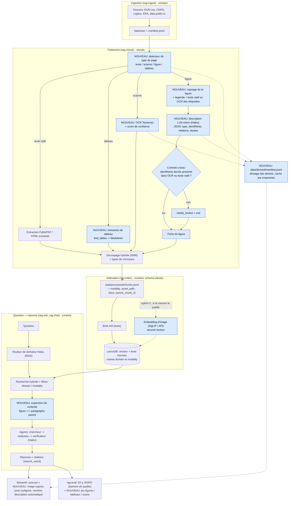
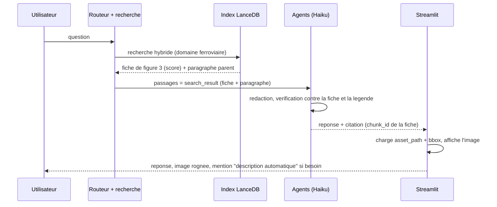

# Contenus non textuels dans le RAG : guide d'aide à la décision

- **Date** : 2026-11-05
- **Statut** : proposition, rien n'est implémenté. C'est FRANKS qui choisit (voir la section 12).
- **Public** : FRANKS, qui prévoit d'ajouter plus tard des documents avec schémas
  (trains, capteurs embarqués), tableaux, images et PDF scannés.
- **Lien avec la feuille de route** : touche l'étape 3 (extraction, découpage),
  l'étape 4 (recherche, citations), l'étape 5 (évaluation), l'étape 7
  (fine-tuning) et l'étape 8 (élargir le corpus, domaine `ferroviaire`).

Acronymes expliqués à leur première apparition. Les prix et noms d'outils
changent vite : tout ce qui est marqué « à revérifier » doit l'être le jour
où on décide, pas avant.

---

## 1. En bref (à lire si vous n'avez que 3 minutes)

**Réponse courte à « faut-il de l'OCR ? »** : pas par défaut. L'OCR
(Optical Character Recognition, reconnaissance optique de caractères : lire du
texte dans une image) n'est utile que pour les pages **scannées** ou les
**images contenant du texte** (étiquettes d'un schéma, photo de plaque). Un PDF
« numérique » contient déjà son texte, y compris dans beaucoup de schémas
vectoriels : on le lit directement, sans OCR, avec les coordonnées.

**Ce qu'il faut réellement ajouter**, dans cet ordre de rentabilité :

1. **Un détecteur de type de page** (texte / scanné / figure / tableau), pour
   ne pas appliquer les outils chers partout. Aujourd'hui `extract_pdf`
   ignore les images et renvoie une liste vide pour un PDF scanné : on ne le
   voit même pas (voir `src/rag_rgpd/processing/pdf.py`).
2. **Une extraction fidèle des tableaux** (en Markdown, avec les en-têtes
   répétés dans chaque morceau). Gain élevé, coût nul.
3. **Une « fiche de figure »** pour chaque schéma : légende d'origine +
   texte du document qui le commente + texte lu dans l'image (étiquettes) +
   description rédigée par un LLM vision (modèle qui comprend les images),
   le tout **en texte**, chunké et indexé comme le reste.
4. **L'image elle-même conservée à côté** (fichier + page + zone), pour
   l'afficher dans le chat comme source citée.
5. **Seulement ensuite, si la mesure le justifie** : embeddings multimodaux
   (vecteurs qui placent texte et image dans le même espace) ou recherche
   directe sur les images de pages (famille ColPali).

**Recommandation** : option B de la section 9 (« fiche de figure par
description vision, tout en Haiku, avec OCR ciblé seulement pour les
identifiants exacts »). Elle réutilise tout le pipeline existant (BGE-M3,
LanceDB, citations de l'API, vérificateur, `rag-eval`), ne demande presque
aucun nouveau modèle à installer, et coûte quelques dizaines de centimes pour
quelques centaines de figures (section 10). Les embeddings d'images (option C)
et la recherche visuelle de pages (option D) se décident **après** avoir
mesuré ce que B rate.

**Fine-tuning** : ne change pas tant qu'on n'a pas mesuré. Le chunking et
l'indexation changent beaucoup ; l'entraînement (étape 7, en pause) peut
rester en pause (section 8).

**Point à trancher avant tout** : si les schémas viennent de documents
internes d'une entreprise, les envoyer à une API de LLM vision les fait sortir
de la machine. Le `CLAUDE.md` du projet interdit les données d'un employeur ;
on parle donc ici de documents **publics** (STI de l'ERA, normes publiques,
notices de constructeurs publiées). Voir la section 11.

---

## 2. Ce qu'on appelle « contenu non textuel » : cinq cas, cinq traitements

| Cas | Exemple ferroviaire | Où est l'information ? | Traitement recommandé |
|---|---|---|---|
| **PDF numérique avec figures vectorielles** | schéma de signalisation d'une STI | texte et traits sont dans le fichier | lire les mots avec coordonnées (PyMuPDF), ne pas faire d'OCR ; rendre la figure en image pour la description |
| **Tableau** | tableau de paramètres d'une STI, horaires | cellules dans le PDF ou l'HTML | extraction de tableau → Markdown, découpage par lignes avec en-têtes répétés |
| **PDF scanné ou photo** | ancienne notice numérisée, photo de plaque | seulement des pixels | OCR (ou LLM vision), avec contrôle de qualité |
| **Schéma raster (PNG/JPG)** | plan d'implantation de capteurs sur une voiture | pixels + étiquettes dessinées | OCR pour les identifiants exacts + description vision pour le sens |
| **Plan technique source (DXF, SVG, IFC)** | plan CAO exporté | fichier structuré | si on a le fichier source, lire sa structure directement (calques, textes, blocs) : plus fiable que n'importe quelle image |

Règle générale : **plus on garde de structure à la source, moins on dépend
d'un modèle qui devine.** Toujours préférer, dans cet ordre :
texte natif → structure native (vecteur, tableau) → OCR → description par
LLM vision.

Particularités des schémas techniques, qui les rendent plus durs que des
photos :

- texte **petit, tourné, superposé** aux traits (références de câbles,
  numéros de bornes) : l'OCR classique le rate souvent ;
- l'information est dans les **relations** (« le capteur 3 est relié au boîtier
  B2 ») que ni l'OCR ni un vecteur d'image ne capturent bien ;
- les LLM vision comprennent la structure générale mais **inventent ou
  confondent des identifiants** (un « B2 » devient « B3 »). Pour la sécurité
  ferroviaire c'est le risque principal (registre des risques, section 11,
  en fin de document).

---

## 3. Les briques, une par une

### 3.1 Détecter le type de chaque page (à faire avant tout)

Pour chaque page d'un PDF, mesurer avec PyMuPDF :

- nombre de caractères de texte natif ;
- nombre et surface des images (`page.get_images`, `page.get_image_info`) ;
- nombre de tracés vectoriels (`page.get_drawings`), fort pour un schéma ;
- présence de tableaux (`page.find_tables`).

Décision simple, sans modèle :

| Texte natif | Images / tracés | Type de page | Suite |
|---|---|---|---|
| beaucoup | peu | texte | pipeline actuel |
| beaucoup | beaucoup de tracés | texte + figure vectorielle | texte actuel + fiche de figure |
| presque rien | une image plein page | **scannée** | OCR ou vision |
| moyen | tableau détecté | tableau | extraction de tableau |

Cette étape est gratuite, locale, et sert aussi de **rapport d'ingestion** :
« 12 pages scannées sur 140, 9 figures, 4 tableaux ». Elle évite le piège
actuel du PDF scanné qui disparaît en silence.

### 3.2 OCR : quand c'est utile, quand c'est inutile

**Inutile** : PDF avec texte natif ; schémas vectoriels (le texte est dans le
fichier) ; HTML.

**Utile** : pages scannées ; images raster contenant du texte ; plans exportés
en image.

Options (à revérifier le jour J) :

| Outil | Nature | Points forts | Limites |
|---|---|---|---|
| **Tesseract** (via OCRmyPDF) | local, libre (Apache 2.0) | gratuit, bon sur texte imprimé propre, ajoute une couche texte au PDF | faible sur texte tourné, petit, schémas, tableaux |
| **PaddleOCR** / **docTR** / **EasyOCR** | local, libres | meilleurs sur mise en page difficile, texte tourné | installation plus lourde (PyTorch ou Paddle), GPU conseillé |
| **Mistral OCR**, **Azure Document Intelligence**, **Google Document AI** | API payantes | très bons sur tableaux et mises en page, sortie structurée | coût par page, données envoyées chez un fournisseur |
| **LLM vision (Claude Haiku)** | API | lit et comprend en même temps, gère le français technique | peut « corriger » ou inventer ; coût par image ; pas de coordonnées fiables |

Recommandation : **Tesseract (français + anglais) en local pour les pages
scannées de texte courant**, et **OCR ciblé sur les figures uniquement pour
extraire la liste des identifiants exacts** (références, numéros de bornes)
qui serviront à contrôler la description (section 3.4). Garder le score de
confiance de l'OCR : en dessous d'un seuil, on bascule la page vers la
vision ou on la signale.

Piège RGPD : un scan peut contenir des données personnelles (signatures,
noms). Le traiter comme n'importe quelle source : fiche de source, licence,
pas de publication des fichiers bruts.

### 3.3 Mise en page (layout) et tableaux

Aujourd'hui : PyMuPDF `sort=True`, un bloc ≈ un paragraphe. Limites déjà
connues : diapositives à deux colonnes lues dans le désordre, références de
page parasites (`docs/decisions/0005`, `project-plan-phases`).

| Option | Apport | Coût / limite |
|---|---|---|
| **PyMuPDF `find_tables()`** (déjà installé) | tableaux simples bordés, cellules, export Markdown | rate les tableaux sans bordures ou fusionnés |
| **pdfplumber** | tableaux, positions précises des mots | un peu lent, deuxième bibliothèque |
| **PyMuPDF4LLM** | PDF → Markdown (titres, tableaux, listes) en une passe | licence AGPL comme PyMuPDF (déjà acceptée, décision 0005) |
| **Docling** (IBM) | titres, tableaux, figures, ordre de lecture par modèles | écartée en 0005 car lourde (modèles de plusieurs Go) ; à reconsidérer **en option** si les PDF réels sont complexes |
| **Unstructured**, **Marker** | pipelines complets | dépendances nombreuses ; mêmes réserves |

Recommandation : **`find_tables()` + éventuellement PyMuPDF4LLM**, puis
mesurer. Docling seulement si ces deux-là échouent sur les vrais documents.
Les tableaux deviennent du **Markdown**, la forme que les LLM lisent le mieux.

### 3.4 Décrire une image avec un LLM vision

Principe : on envoie l'image (la figure rognée, pas la page entière si
possible) à Claude avec une consigne stricte, et on récupère un **texte** qui
sera indexé comme n'importe quel morceau.

Contenu d'une bonne consigne pour un schéma technique :

1. **Ce qu'on voit** : type (plan, schéma bloc, courbe), titre, légende.
2. **Éléments et identifiants**, recopiés **tels qu'ils sont écrits**, sans
   correction ni complétion ; « illisible » plutôt qu'une supposition.
3. **Relations** : qui est relié à quoi, sens des flèches, unités.
4. **Ce qu'on ne sait pas** : zones floues, légendes manquantes.
5. Réponse en JSON (type, identifiants, relations, doute) pour pouvoir la
   contrôler automatiquement.

**Contrôle croisé gratuit (recommandé)** : l'OCR ciblé (ou le texte natif du
PDF vectoriel) donne la liste des identifiants réellement présents. Tout
identifiant cité dans la description mais **absent** de cette liste est
suspect : on le retire ou on envoie la fiche en revue humaine. C'est la
meilleure parade connue contre l'invention de références.

Modèle : **Haiku par défaut** (cohérent avec la décision 0014 : agents en
Haiku, Sonnet en option). Pour les figures difficiles seulement, repasser en
Sonnet (`--vision-model`, nom à décider). Les descriptions sont calculées
**une seule fois à l'ingestion** et gardées en cache par empreinte du fichier
(comme le cache des réponses, étape 4 bis) : le coût n'est pas répété.

Alternative locale (aucune donnée ne sort) : un modèle vision ouvert (famille
Qwen-VL, Llama vision, etc.) via Ollama ou llama.cpp. Gratuit à l'usage mais
demande un GPU correct, et qualité moindre sur les schémas techniques
français. À réserver aux documents qui ne peuvent pas partir sur une API.

### 3.5 Embeddings multimodaux : à quoi ça sert vraiment

Un embedding multimodal place texte et image dans le **même** espace de
vecteurs : on peut chercher une image avec une phrase, sans passer par une
description.

| Famille | Exemples (à revérifier) | Bon pour | Limite |
|---|---|---|---|
| **CLIP / SigLIP** | SigLIP 2, Jina CLIP v2 | photos, scènes, logos ; recherche image par texte court | faible sur le texte fin et les schémas techniques ; texte long mal géré |
| **Embeddings multimodaux commerciaux** | Voyage multimodal, Cohere Embed v4 (API) | documents mêlant texte et images, un seul index | coût par appel, dépendance fournisseur, pas dans le dépôt aujourd'hui |
| **ColPali / ColQwen** (retrieval « sur images de pages ») | ColQwen2 et dérivés | pages riches (tableaux, schémas) sans OCR ni layout ; fort sur le benchmark ViDoRe | multi-vecteurs par page (stockage et recherche différents), GPU quasi indispensable, cite une **page** et pas une phrase |

Ce que ça change à notre pipeline : **BGE-M3 est texte seulement** (décision
0007). Si on ajoute un embedding d'images, il faut un **second vecteur** (ou
un second index) avec sa propre dimension ; la recherche fusionne alors deux
listes (comme la fusion RRF, Reciprocal Rank Fusion, déjà utilisée entre
vecteur et texte). Les index actuels refusent déjà un autre modèle sur le même
index (`IndexMismatchError`) : c'est une bonne protection, à conserver.

Avis : pour des **schémas techniques français**, une description textuelle
bien faite + BGE-M3 donne en général de meilleurs résultats qu'un CLIP, car la
question de l'utilisateur est une phrase précise (« où se trouve le capteur
de vitesse sur la voiture ? ») et non une image. Les embeddings d'images
deviennent intéressants quand il y a **des milliers** de photos sans légende,
ou quand l'utilisateur cherche « par ressemblance ». À mesurer, pas à
supposer.

### 3.6 Découpage (chunking) adapté aux figures et aux tableaux

Le découpage actuel (décision 0006) part de la structure (article,
considérant, page), fusionne les pages courtes, découpe par paragraphe jusqu'à
1 500 caractères. Il faut y ajouter des **types de morceaux** :

| Type (`modality`) | Unité de découpe | Contenu du morceau |
|---|---|---|
| `text` | comme aujourd'hui | texte |
| `table` | le tableau entier s'il tient dans 1 500 caractères, sinon **groupes de lignes avec la ligne d'en-têtes répétée** et le titre du tableau | Markdown |
| `figure` | **une figure = un morceau** (jamais coupée) | « fiche de figure » : légende d'origine, phrases du texte qui la citent (« voir figure 3 »), identifiants lus par OCR, description du LLM vision |
| `scan_text` | comme `text` après OCR | texte OCR + confiance moyenne |

Règles utiles :

- **Rattacher à son contexte** : la fiche garde `heading` (chapitre, section)
  et `parent_chunk_id` (le morceau de texte qui la mentionne). Ainsi, quand
  la recherche trouve la figure, on peut aussi envoyer le paragraphe qui
  l'explique, et inversement.
- **Légende d'abord** : la légende d'origine est une source plus fiable que la
  description du LLM ; elle est placée en tête de la fiche et citée en
  priorité.
- **Ne pas dépasser le plafond** : une fiche très longue (grand schéma bloc)
  est découpée par zone (sous-figures), pas par nombre de caractères.
- **Un tableau n'est pas un paragraphe** : ne jamais le couper sans répéter
  les en-têtes, sinon une ligne « 120 | 3,5 | N/A » devient incompréhensible.

---

## 4. Indexation et traçabilité (lineage)

### 4.1 Ce qui s'ajoute au schéma des morceaux

`Chunk` et le schéma LanceDB (`retrieval/index.py::_schema`) reçoivent des
champs **optionnels**, avec valeurs par défaut pour que les anciens
`chunks.jsonl` restent lisibles (comme cela a été fait pour `domain` en 0015) :

| Champ | Rôle |
|---|---|
| `modality` | `text` (défaut), `table`, `figure`, `scan_text` |
| `asset_path` | chemin de l'image rognée (relatif à `data/`), pour l'afficher |
| `bbox` | zone sur la page (x0, y0, x1, y1) pour surligner la figure |
| `parent_chunk_id` | morceau de texte qui la mentionne |
| `derived_by` | outil et version (`pymupdf-1.x`, `tesseract-5`, `claude-haiku-5-5`) |
| `prompt_sha256` | empreinte de la consigne de description (reproductibilité) |
| `ocr_confidence` | confiance moyenne (0 à 1) si OCR |
| `needs_review` | drapeau si un identifiant n'a pas passé le contrôle croisé |

L'index change de schéma : réindexer sur le PC (comme à l'étape 8a), environ
30 minutes actuellement avec BGE-M3 pour 1 907 morceaux.

### 4.2 Manifeste JSONL

Le manifeste (`data/manifest.jsonl`) reste la source de vérité des **fichiers
téléchargés**. Les produits dérivés (images rognées, textes OCR, descriptions)
sont enregistrés dans un second fichier, `data/derived/manifest.jsonl`, avec :
l'empreinte du fichier brut parent, la page, la zone, l'outil et sa version, le
modèle et l'empreinte de la consigne, la date, le coût. Ainsi on peut toujours
répondre à : « d'où vient cette phrase de description, avec quel modèle, sur
quelle version du document ? » et **invalider** les dérivés quand la source
change (le `chunk_id` contient déjà l'empreinte du brut).

### 4.3 Licences

Les images rognées d'un document CNPD sont des dérivés de documents à **usage
privé** : elles restent hors de Git, comme `data/raw/`. Pour les textes
EUR-Lex (CC BY 4.0) et data.public.lu (CC0), les figures peuvent être
publiées avec mention de source. À consigner dans la fiche de chaque source.

---

## 5. Recherche, génération, citations d'images

### 5.1 Recherche

Rien à changer pour le texte : BGE-M3 sur la fiche de figure, recherche
hybride vecteur + texte français, filtre `--domain`. Ajouts utiles :

- filtre optionnel `--modality` (comme `--domain`) ;
- **expansion contexte** : si un morceau `figure` est retenu, ajouter son
  `parent_chunk_id` ; si un morceau de texte dit « voir figure 3 », ajouter la
  fiche de la figure 3 ;
- seuil de refus (0,45 aujourd'hui) à **recalibrer pour les fiches** : une
  fiche descriptive a souvent des similarités plus basses qu'un article de loi.
  Même méthode qu'en 0015 : questions de chaque type + hors-sujet.

### 5.2 Génération avec citations

Aujourd'hui les passages sont envoyés comme blocs `search_result` à texte,
citations activées (décision 0009) et l'API renvoie le morceau exact. Pour les
figures, la solution qui s'insère **sans rien casser** est : **la fiche de
figure est un `search_result` comme les autres**. La citation désigne donc la
fiche (son `chunk_id`), et c'est l'interface qui, à partir de `asset_path` et
`bbox`, affiche l'image et surligne la zone.

Deux variantes plus ambitieuses (à ne faire qu'après mesure) :

- **Envoyer aussi l'image au modèle** quand la question porte sur le visuel
  (« combien de capteurs sur ce plan ? ») : le modèle regarde l'image directement.
  Les citations natives de l'API portent sur du texte ; la vérification de ce
  que le modèle a « vu » devrait alors être faite par le vérificateur (réponse
  contre fiche), pas par l'API. À revérifier dans la documentation de l'API.
- **Répondre avec l'image jointe** dans l'interface (toujours possible, même
  sans la variante précédente).

Règle d'honnêteté à ajouter à la consigne du rédacteur : une information qui
vient **uniquement** de la description automatique est présentée comme telle
(« d'après la description automatique de la figure 3 ») ; une information
confirmée par la légende ou le texte voisin est citée normalement.

### 5.3 Agents (étape 6)

- **Chercheur** : sa consigne est aujourd'hui centrée RGPD (limite connue,
  mémoire de l'étape 8a). Il doit apprendre à reformuler pour les figures
  (« schéma », « plan », « tableau », noms de composants).
- **Rédacteur** : règle d'honnêteté ci-dessus.
- **Vérificateur** : il vérifie chaque affirmation contre le texte des
  morceaux. **Risque propre au multimodal** : si la description du LLM vision
  est fausse, le vérificateur la trouvera « conforme à la source », car la
  source est la description elle-même. Parades : contrôle croisé des
  identifiants (3.4), légende d'origine prioritaire, drapeau `needs_review`
  qui force le refus ou l'avertissement, et un échantillon de descriptions
  relues à la main (section 7).
- **Routeur de domaine** (décision 0016) : inchangé ; ajouter au besoin un
  indice « question visuelle » pour activer l'expansion de contexte.

### 5.4 Interface Streamlit

Dans l'expander « Sources » (`chat/app.py`), pour un morceau `figure` : afficher
l'image (`st.image`) avec la légende, la page et le lien vers la source ; dans
« Coulisses » : le texte de la fiche, la confiance OCR, le modèle de
description, le drapeau de revue. Pas besoin de nouvelle technologie.

---

## 6. Architecture cible

S'insère dans l'existant : les rectangles nouveaux sont en bleu, les
existants en gris.



Flux d'une question visuelle (« où est le capteur de vitesse sur la voiture
motrice ? »), pour comprendre la citation :



---

## 7. Évaluation (`rag-eval`)

Principe de la barrière de qualité (CLAUDE.md) : **les 52 questions RGPD ne
doivent pas reculer** quand on ajoute des figures. On mesure donc d'abord sans
filtre, comme pour l'étape 8.

Nouveau jeu `tests/cases/questions-multimodal.yaml` (même format, champs en
plus, sans changer le format actuel) :

| Champ | Sens |
|---|---|
| `modalite` | `figure`, `tableau`, `scan` |
| `source_figure` | identifiant de la figure attendue (ex. `sti-ctrl-fig-3`) |
| `valeur_attendue` | pour un tableau : la cellule exacte (« 160 km/h ») |
| `identifiants_attendus` | liste de références qui doivent apparaître |

Au moins 10 à 15 questions par modalité, **écrites à la main** à partir de
vrais documents, dont des hors-sujet (refus attendu) et des pièges (deux
figures voisines, un identifiant proche).

Mesures à ajouter (en plus de celles de `evaluation/metrics.py`) :

| Mesure | Comment | Pourquoi |
|---|---|---|
| Retrouvé dans les k | la fiche attendue est dans les k premiers (comme `dans_les_k`) | la figure est-elle trouvée ? |
| Exactitude de cellule | la valeur attendue est dans la réponse | tableaux |
| Taux d'identifiants inventés | identifiants de la réponse absents des sources | hallucination propre aux schémas |
| Qualité OCR | taux d'erreur de caractères sur 20 pages relues à la main | choisir/valider l'OCR |
| Fidélité des descriptions | 30 fiches relues par FRANKS (juste / partielle / fausse) | le point faible du multimodal |
| Refus à tort / à raison | comme aujourd'hui, par modalité | le seuil des fiches |
| Coût par figure / par question | `explain/cost.py` étendu (tokens image) | cible « moins cher » |

Le correcteur reste Haiku (préférence de FRANKS) ; pour les descriptions, une
relecture humaine d'un **petit échantillon** est irremplaçable, un LLM ne
voyant pas les erreurs qu'il a lui-même faites.

Comparaison des options (B, C, D de la section 9) : **mêmes questions, mêmes
documents**, tableau comparatif via `rag-batch`/`rag-eval`, et on ne garde
que ce qui fait mieux, comme prévu à l'étape 7.

---

## 8. Impact sur le fine-tuning et l'entraînement

Il y a trois choses différentes qu'on appelle « entraînement » :

| Quoi | Faut-il l'affiner ? | Quand ça se justifie |
|---|---|---|
| **LLM de réponse** (Claude) | Non. Pas de fine-tuning disponible ou utile ici ; consignes et recherche suffisent. | jamais pour ce besoin |
| **Modèle d'embedding** (BGE-M3, ou un modèle d'image) | Possible : paires (question, fiche/figure) | si la mesure montre que les bonnes figures sont dans le top 20 mais pas le top 3, et qu'on a quelques centaines de paires |
| **Reclasseur** (reranker, déjà présent : `retrieval/rerank.py`, décision 0011) | Le plus rentable des trois | mêmes conditions, avec moins de données |
| **Modèle vision** (description, OCR) | Rarement | seulement si une famille de schémas précise (ex. plans de câblage d'un constructeur) est systématiquement mal décrite et qu'on a des centaines d'exemples corrigés |

Ce qui change vraiment :

- **Les données d'entraînement potentielles augmentent** : chaque description
  relue à la main et chaque question de `questions-multimodal.yaml` devient une
  paire exploitable. À conserver proprement (étiquette « relu humain »).
- **Le chunking change** (section 3.6) : donc **toute mesure de fine-tuning
  doit être refaite** sur le nouveau découpage ; ne pas fine-tuner avant de
  l'avoir stabilisé.
- L'étape 7 reste en pause (décision du 3 nov.). Recommandation : **ne pas la
  rouvrir pour le multimodal** ; commencer par les gains « gratuits »
  (consignes, contexte parent, contrôle croisé). Le fine-tuning d'un
  embedding ou d'un reclasseur n'est à envisager qu'avec le jeu
  multimodal en main, pour le comparer à la version sans.

---

## 9. Options comparées et recommandation

| | **A. Texte seul + légendes** | **B. Fiches de figure par description vision** (recommandée) | **C. B + embeddings d'images** | **D. Recherche visuelle de pages (ColPali)** |
|---|---|---|---|---|
| Principe | on indexe le texte natif et les légendes, les images sont ignorées | B = A + tableaux Markdown + fiche (légende, contexte, OCR ciblé, description Haiku) | B + second vecteur d'image fusionné à la recherche | on indexe des images de pages en multi-vecteurs, pas de texte |
| Nouveaux modèles | aucun | un appel Haiku vision à l'ingestion ; Tesseract local | un modèle d'image (local ou API) | modèle ColQwen (GPU) |
| Citations | comme aujourd'hui | fiche citée, image affichée | idem | page entière, pas de phrase |
| Coût d'ingestion | 0 | faible (section 10) | faible à moyen | moyen, plus GPU |
| Coût par question | inchangé | inchangé (la fiche est du texte) | un peu plus (deux recherches) | plus élevé |
| Fiabilité sur identifiants | dépend des légendes | bonne avec le contrôle croisé | idem | pas de contrôle de texte exact |
| Effort de code | nul | moyen | élevé | élevé, réécriture de la recherche |
| Se combine avec le pipeline actuel | oui | **oui, sans réécriture** | oui avec second index | non, parallèle |
| Risque principal | schémas invisibles | description fausse (parade en 3.4) | gain faible sur schémas techniques | dépendance GPU, stockage |

**Recommandation** : **B**, déployé par paliers (section 12). **A** est le
point de départ obligatoire (il y a déjà des tableaux et du texte à mieux
extraire). **C** et **D** : ne rien décider avant d'avoir une mesure de B sur
de vrais documents ferroviaires ; si B retrouve les bonnes figures dans le
top 3 pour la grande majorité des questions, C et D n'apportent presque rien
pour leur coût.

---

## 10. Coûts

Principes pour rester bon marché (préférence de FRANKS) :

1. **Tout ce qui est local est gratuit** : détection de type de page, lecture
   du texte natif, tableaux, Tesseract, BGE-M3.
2. **Le LLM vision ne voit que ce qui en a besoin** : les figures détectées,
   rognées et réduites, pas toutes les pages.
3. **Une seule fois** : description calculée à l'ingestion, en cache par
   empreinte du fichier brut et empreinte de la consigne. Relancer
   `rag-chunk` ne repaye rien.
4. **Haiku par défaut**, Sonnet seulement pour les figures marquées difficiles.
5. **API par lots** (Message Batches : en général une remise d'environ 50 %,
   résultats différés, pas gênant pour de l'ingestion ; à revérifier) et mise en cache
   des consignes (prompt caching) si on traite beaucoup d'images avec la même
   consigne.
6. **Le coût par question ne change pas** avec B : la fiche est du texte, comme
   un article de loi. C'est l'avantage décisif de B.

Calcul à refaire avec les tarifs du jour (page des tarifs de l'API) :

```
coût vision = nb_figures × (tokens_image + tokens_consigne + tokens_sortie) × tarif
tokens_image ≈ largeur_px × hauteur_px / 750   (image réduite, ordre de 1 000 à 1 600 tokens)
tokens_sortie ≈ 250 à 400 (description JSON)
```

Exemple **illustratif**, avec un tarif **hypothétique** de 1 $ par million de
tokens en entrée et 5 $ en sortie pour Haiku (à remplacer par le vrai tarif) :
200 figures × (1 500 + 400 entrée) ≈ 380 000 tokens → 0,38 $ ; 200 × 350 sortie
= 70 000 tokens → 0,35 $. Soit **de l'ordre de 0,7 $ pour 200 figures**, une
seule fois, et environ la moitié par lots. Même ordre de grandeur que les
0,15 $ de la mesure complète à 52 questions. En revanche, passer toutes les
pages d'un document de 300 pages en vision serait de 5 à 10 fois plus cher
sans gain : d'où la détection préalable.

À côté : OCR commercial (si choisi) : facturé à la page ; Tesseract : 0 $.
Embeddings d'images par API (option C) : quelques centimes pour des centaines
d'images, plus un second index. ColPali (D) : surtout du temps GPU.

Chaque ingestion doit **afficher et journaliser son coût** (champ `cout_usd`
dans le manifeste dérivé), et demander l'accord de FRANKS avant une mesure
payante, comme déjà convenu.

---

## 11. Sécurité, confidentialité, licences, risques

- **Données** : n'envoyer à une API vision que des documents publics et
  autorisés. Si un document ne doit pas sortir de la machine : OCR local +
  modèle vision local, ou ne pas l'ingérer. Le `CLAUDE.md` exclut déjà les
  données de l'employeur de FRANKS ; cela vaut pour les schémas aussi.
- **Licences** : vérifier chaque source avant ingestion (déjà la règle) ;
  les figures de STI sur EUR-Lex suivent la politique de réutilisation de
  l'UE ; les normes (EN, CENELEC) et notices de constructeurs sont
  généralement protégées : les ingérer serait un usage privé au mieux, et
  non publiable.
- **Registre des risques** (à compléter à l'étape correspondante) :

| Risque | Mesure |
|---|---|
| Identifiant inventé ou confondu par la vision (référence de capteur, numéro de borne) | contrôle croisé OCR / texte natif ; drapeau `needs_review` ; légende prioritaire ; mention « description automatique » |
| Information de sécurité ferroviaire fausse présentée comme fiable | l'outil reste une aide, pas un avis d'ingénierie ; refus si `needs_review` et pas de légende |
| Valeur de tableau mal alignée (mauvaise colonne) | tests de cellules exactes ; en-têtes répétés ; comparaison manuelle d'un échantillon |
| OCR de mauvaise qualité qui pollue l'index | seuil de confiance ; page signalée plutôt qu'indexée |
| Données personnelles dans les scans | fiche de source, `data/` hors Git, pas de ré-identification |
| Dépendance au fournisseur de vision | option locale documentée ; consigne et cache versionnés |
| Dérive du coût | journal de coût, plafond par ingestion, accord de FRANKS |

---

## 12. Plan proposé (à valider par FRANKS)

Chaque palier est autonome, mesuré, et peut s'arrêter là. Comme toujours :
explications des concepts, options d'outils présentées, **FRANKS choisit**, une
décision écrite par choix (numérotation suite : 0017, 0018...).

| Palier | Contenu | Gain attendu | Coût |
|---|---|---|---|
| **M0. Audit** | détecteur de type de page + rapport sur les PDF déjà ingérés (combien de pages scannées, figures, tableaux ?) | savoir si le problème existe vraiment | 0 |
| **M1. Tableaux et ordre de lecture** | `find_tables` → Markdown, en-têtes répétés ; corrections de colonnes | meilleures réponses sur les données chiffrées | 0 |
| **M2. Jeu d'essai multimodal** | 30 à 45 questions écrites à la main sur vrais documents (figures, tableaux, scans) ; mesure de la ligne de base **sans** figures (option A) | chiffre de départ | 0 à 0,2 $ |
| **M3. Fiches de figure** | rognage, légende, texte natif/OCR ciblé, description Haiku, contrôle croisé, champs d'index, affichage dans le chat | l'essentiel du gain visuel | environ 1 $ pour quelques centaines de figures |
| **M4. OCR des pages scannées** | Tesseract + seuil de confiance | rend lisibles les anciens scans | 0 |
| **M5. Décision C/D** | comparer B à C (et D) sur le jeu M2 | décider avec des chiffres | selon option |
| **M6. Reclasseur ou embedding affiné** | seulement si M5 montre un manque | dernier recours | GPU/temps |

À préciser par FRANKS pour avancer :

1. **Quels documents réels** (liens ou fichiers publics) contiennent les
   schémas visés ? Sans eux, M0/M2 restent théoriques.
2. Ces documents peuvent-ils être **envoyés à une API** ?
3. Y a-t-il des **fichiers sources** (SVG, DXF) en plus des PDF ?
4. Faut-il que la réponse **montre l'image** (recommandé) ou seulement la
   décrire ?

---

## Glossaire

- **OCR** (Optical Character Recognition) : lecture du texte contenu dans une image.
- **LLM vision / VLM** : modèle de langage qui accepte aussi des images.
- **Layout** : mise en page (colonnes, titres, tableaux, figures) et ordre de lecture.
- **Embedding** : vecteur de nombres résumant le sens d'un texte (ou d'une image).
- **Embedding multimodal** : vecteur commun pour texte et image.
- **CLIP / SigLIP** : modèles qui relient texte et image dans un même espace de vecteurs.
- **ColPali / ColQwen** : modèles de recherche qui comparent la question à des images de pages (plusieurs vecteurs par page).
- **Multi-vecteurs** : plusieurs vecteurs pour un même objet (par zone de la page).
- **RRF** (Reciprocal Rank Fusion) : fusion de plusieurs classements de résultats.
- **Chunk / morceau** : unité de texte indexée et citée.
- **Bbox** (bounding box) : rectangle qui délimite une zone sur une page.
- **STI** (Spécifications techniques d'interopérabilité) : textes européens qui fixent les exigences techniques du matériel et des infrastructures ferroviaires.
- **ERA** (Agence de l'Union européenne pour les chemins de fer) : publie guides et STI.
- **CER** (Character Error Rate) : proportion de caractères mal lus par l'OCR.
- **DXF / SVG / IFC** : formats de plans (CAO, dessin vectoriel, bâtiment) qui contiennent la structure du dessin.
- **Lineage** : traçabilité de l'origine d'une donnée et de ses transformations.
